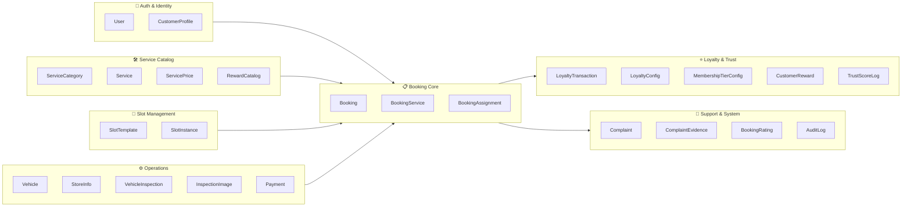

# ERD — AutoWash Pro

**BRD Version:** v2.3 | **Tổng số entities:** 25 | **Ngày:** 2026-05-23

---

## 1. Tổng quan Domain

---

## 2. Full ERD — Toàn hệ thống

```mermaid
erDiagram

  User {
    UUID user_id PK
    VARCHAR full_name
    VARCHAR email
    VARCHAR phone
    VARCHAR password_hash
    ENUM role
    ENUM status
    BOOLEAN email_verified
    TIMESTAMP created_at
    TIMESTAMP updated_at
  }

  CustomerProfile {
    UUID customer_id PK
    UUID user_id FK
    ENUM membership_tier
    INT total_points
    BIGINT total_spending_12m
    INT trust_score
    INT platinum_exempt_count
    DATE platinum_exempt_reset_at
    TIMESTAMP tier_achieved_at
    TIMESTAMP tier_review_at
    INT no_show_count
    INT birth_month
  }

  StoreInfo {
    UUID store_id PK
    VARCHAR name
    TEXT address
    VARCHAR phone
    TIME opening_time
    TIME closing_time
    TIMESTAMP updated_at
  }

  Vehicle {
    UUID vehicle_id PK
    UUID customer_id FK
    VARCHAR license_plate
    VARCHAR brand
    VARCHAR model
    VARCHAR color
    ENUM vehicle_size
    TEXT notes
    ENUM status
    TIMESTAMP created_at
  }

  ServiceCategory {
    UUID category_id PK
    VARCHAR name
    TEXT description
    INT display_order
    BOOLEAN is_wash_group
  }

  Service {
    UUID service_id PK
    UUID category_id FK
    VARCHAR service_code
    VARCHAR name
    TEXT description
    INT estimated_duration_minutes
    ENUM status
    TIMESTAMP created_at
  }

  ServicePrice {
    UUID price_id PK
    UUID service_id FK
    ENUM vehicle_size
    BIGINT price
    DATE effective_from
  }

  SlotTemplate {
    UUID template_id PK
    INT day_of_week
    TIME start_time
    TIME end_time
    INT active_bays
    INT min_washers_per_car
  }

  SlotInstance {
    UUID slot_id PK
    UUID template_id FK
    DATE date
    TIME start_time
    TIME end_time
    INT active_bays
    INT washers_online
    INT min_washers_per_car
    INT capacity
    INT booked_count
    INT held_count
    ENUM status
  }

  Booking {
    UUID booking_id PK
    UUID customer_id FK
    UUID vehicle_id FK
    ENUM booking_type
    ENUM booking_source
    UUID start_slot_id FK
    INT num_slots
    ENUM status
    VARCHAR voucher_code FK
    BIGINT discount_amount
    BIGINT estimated_total_price
    BIGINT final_total_price
    INT estimated_duration_minutes
    TIMESTAMP hold_expires_at
    TIMESTAMP t2h_reminder_sent_at
    TIMESTAMP t2h_confirmed_at
    TIMESTAMP confirmed_at
    TIMESTAMP checked_in_at
    TIMESTAMP completed_at
    TIMESTAMP closed_at
    UUID cancelled_by FK
    TIMESTAMP cancelled_at
    TEXT cancellation_reason
    BOOLEAN penalty_applied
    UUID created_by FK
    TEXT notes
    TIMESTAMP created_at
  }

  BookingService {
    UUID booking_service_id PK
    UUID booking_id FK
    UUID service_id FK
    BIGINT price_snapshot
    INT duration_snapshot
  }

  BookingAssignment {
    UUID assignment_id PK
    UUID booking_id FK
    UUID car_washer_id FK
    UUID assigned_by FK
    TIMESTAMP assigned_at
    ENUM status
  }

  VehicleInspection {
    UUID inspection_id PK
    UUID booking_id FK
    UUID inspected_by FK
    ENUM inspection_type
    TEXT exterior_condition
    TEXT interior_condition
    TEXT notes
    BOOLEAN customer_confirmed
    TIMESTAMP customer_confirmed_at
    TIMESTAMP created_at
  }

  InspectionImage {
    UUID image_id PK
    UUID inspection_id FK
    VARCHAR image_url
    TEXT description
    TIMESTAMP uploaded_at
  }

  Payment {
    UUID payment_id PK
    UUID booking_id FK
    BIGINT amount
    ENUM method
    ENUM status
    VARCHAR payos_order_code
    VARCHAR payos_payment_link_id
    TIMESTAMP paid_at
    UUID created_by FK
    TIMESTAMP created_at
  }

  MembershipTierConfig {
    UUID config_id PK
    ENUM tier
    BIGINT spending_threshold
    DECIMAL point_multiplier
    INT booking_window_days
    BOOLEAN is_active
    TIMESTAMP updated_at
  }

  LoyaltyConfig {
    UUID config_id PK
    INT conversion_rate
    INT point_expiry_months
    UUID updated_by FK
    TIMESTAMP updated_at
  }

  LoyaltyTransaction {
    UUID transaction_id PK
    UUID customer_id FK
    UUID booking_id FK
    ENUM type
    INT points
    TEXT description
    UUID created_by FK
    TIMESTAMP created_at
  }

  RewardCatalog {
    UUID reward_id PK
    VARCHAR name
    ENUM reward_type
    INT points_required
    BIGINT value
    UUID service_id FK
    INT valid_days
    ENUM status
    ENUM min_tier_required
  }

  CustomerReward {
    UUID customer_reward_id PK
    UUID customer_id FK
    UUID reward_id FK
    VARCHAR voucher_code
    ENUM status
    TIMESTAMP redeemed_at
    TIMESTAMP expires_at
    TIMESTAMP used_at
    UUID used_in_booking FK
  }

  TrustScoreLog {
    UUID log_id PK
    UUID customer_id FK
    UUID booking_id FK
    ENUM event_type
    INT score_before
    INT score_change
    INT score_after
    BOOLEAN is_platinum_exempted
    TIMESTAMP created_at
  }

  Complaint {
    UUID complaint_id PK
    UUID booking_id FK
    UUID customer_id FK
    ENUM status
    VARCHAR title
    TEXT description
    TEXT resolution_note
    UUID handled_by FK
    TIMESTAMP created_at
    TIMESTAMP updated_at
    TIMESTAMP closed_at
  }

  ComplaintEvidence {
    UUID evidence_id PK
    UUID complaint_id FK
    VARCHAR file_url
    TEXT description
    UUID uploaded_by FK
    TIMESTAMP uploaded_at
  }

  BookingRating {
    UUID rating_id PK
    UUID booking_id FK
    UUID customer_id FK
    UUID car_washer_id FK
    INT overall_score
    INT service_quality_score
    INT staff_attitude_score
    TEXT comment
    TIMESTAMP created_at
  }

  AuditLog {
    UUID audit_id PK
    UUID actor_id FK
    VARCHAR action
    VARCHAR entity_type
    UUID entity_id
    NVARCHAR_MAX old_value
    NVARCHAR_MAX new_value
    VARCHAR ip_address
    TIMESTAMP created_at
  }

  Notification {
    UUID notification_id PK
    UUID user_id FK
    VARCHAR type
    VARCHAR title
    TEXT body
    BOOLEAN is_read
    UUID booking_id FK
    TIMESTAMP created_at
  }

  User ||--o| CustomerProfile : "has profile"
  CustomerProfile ||--o{ Vehicle : "owns"
  ServiceCategory ||--o{ Service : "groups"
  Service ||--o{ ServicePrice : "priced by size"
  RewardCatalog }o--o| Service : "linked service"
  SlotTemplate ||--o{ SlotInstance : "generates"
  CustomerProfile ||--o{ Booking : "makes"
  Vehicle ||--o{ Booking : "used in"
  SlotInstance ||--o{ Booking : "start slot of"
  Booking ||--o{ BookingService : "contains"
  Service ||--o{ BookingService : "included in"
  Booking ||--o{ BookingAssignment : "assigned to"
  User ||--o{ BookingAssignment : "washer"
  Booking ||--o{ VehicleInspection : "has"
  User ||--o{ VehicleInspection : "performed by"
  VehicleInspection ||--o{ InspectionImage : "has images"
  Booking ||--o| Payment : "generates"
  CustomerProfile ||--o{ LoyaltyTransaction : "point history"
  Booking ||--o{ LoyaltyTransaction : "triggers"
  RewardCatalog ||--o{ CustomerReward : "instantiates"
  CustomerProfile ||--o{ CustomerReward : "holds"
  CustomerReward }o--o| Booking : "applied in"
  CustomerProfile ||--o{ TrustScoreLog : "score history"
  Booking ||--o{ TrustScoreLog : "triggers"
  Booking ||--o{ Complaint : "receives"
  CustomerProfile ||--o{ Complaint : "files"
  Complaint ||--o{ ComplaintEvidence : "has evidence"
  Booking ||--o| BookingRating : "rated once"
  CustomerProfile ||--o{ BookingRating : "rates"
  User ||--o{ AuditLog : "generates"
  User ||--o{ Notification : "receives"
  Booking }o--o| Notification : "linked to"
```

---

## 3. Relationship Matrix

| Entity | Quan hệ với | Cardinality | Ghi chú |
|---|---|---|---|
| **User** | CustomerProfile | 1 → 0..1 | Chỉ role CUSTOMER có CustomerProfile |
| **User** | BookingAssignment | 1 → N | Washer nhận nhiều task |
| **User** | VehicleInspection | 1 → N | Car Washer thực hiện inspection |
| **User** | AuditLog | 1 → N | Mọi actor ghi audit |
| **CustomerProfile** | Vehicle | 1 → N | Khách có nhiều xe |
| **CustomerProfile** | Booking | 1 → N | Khách có nhiều booking |
| **CustomerProfile** | LoyaltyTransaction | 1 → N | Lịch sử điểm |
| **CustomerProfile** | CustomerReward | 1 → N | Voucher đã đổi |
| **CustomerProfile** | TrustScoreLog | 1 → N | Lịch sử trust score |
| **CustomerProfile** | Complaint | 1 → N | Khách gửi nhiều khiếu nại |
| **CustomerProfile** | BookingRating | 1 → N | Khách đánh giá nhiều booking |
| **ServiceCategory** | Service | 1 → N | Nhóm chứa nhiều dịch vụ |
| **Service** | ServicePrice | 1 → N | 3 mức giá (S/M/L) per service |
| **Service** | BookingService | 1 → N | Dịch vụ xuất hiện trong nhiều booking |
| **Service** | RewardCatalog | 1 → 0..1 | Linked service cho Free Wash reward |
| **SlotTemplate** | SlotInstance | 1 → N | Template sinh ra slot thực tế (cron daily) |
| **SlotInstance** | Booking | 1 → N | 1 slot là start_slot của nhiều booking FLEX |
| **Booking** | BookingService | 1 → N (≥1) | Phải có ít nhất 1 dịch vụ |
| **Booking** | BookingAssignment | 1 → N | Nhiều record do reassign |
| **Booking** | VehicleInspection | 1 → 0..2 | BEFORE và AFTER service |
| **Booking** | Payment | 1 → 0..1 | Payment tạo sau COMPLETED |
| **Booking** | LoyaltyTransaction | 1 → 0..N | EARN sau PAID, REDEEM khi đặt |
| **Booking** | TrustScoreLog | 1 → 0..N | Cancel / no-show gây thay đổi |
| **Booking** | Complaint | 1 → 0..N | Complaint trong vòng 7 ngày |
| **Booking** | BookingRating | 1 → 0..1 | Chỉ 1 rating (unique constraint) |
| **Booking** | CustomerReward | N → 0..1 | Áp 1 voucher / booking |
| **VehicleInspection** | InspectionImage | 1 → N (≥1) | Phải có ít nhất 1 ảnh |
| **RewardCatalog** | CustomerReward | 1 → N | 1 catalog item sinh nhiều voucher |
| **Complaint** | ComplaintEvidence | 1 → N | Nhiều file đính kèm |

---

## 4. Constraints

| # | Type | Entity / Field | Mô tả |
|---|---|---|---|
| C-01 | UNIQUE | `User.phone` | 1 SĐT duy nhất trong hệ thống |
| C-02 | UNIQUE | `User.email` | 1 email duy nhất |
| C-03 | UNIQUE | `Vehicle.license_plate` | 1 biển số duy nhất |
| C-04 | UNIQUE | `CustomerReward.voucher_code` | Mã voucher không trùng |
| C-05 | UNIQUE | `BookingRating.booking_id` | 1 booking chỉ có 1 rating |
| C-06 | UNIQUE | `(ServicePrice.service_id, vehicle_size, effective_from)` | Không trùng bảng giá cùng ngày |
| C-07 | CHECK | `Booking.num_slots >= 1` | FLEX = 1, WASH >= 1 |
| C-08 | CHECK | `SlotInstance.booked_count <= capacity` | Không overbooking |
| C-09 | CHECK | `CustomerProfile.trust_score BETWEEN 0 AND 100` | |
| C-10 | CHECK | `BookingRating.*_score BETWEEN 1 AND 5` | Rating 1-5 |
| C-11 | NOT NULL | `InspectionImage.inspection_id` | Phải có ít nhất 1 ảnh per inspection |
| C-12 | IMMUTABLE | `LoyaltyTransaction`, `TrustScoreLog`, `AuditLog`, `BookingRating` | Không UPDATE/DELETE |
| C-13 | NOT NULL | `Booking.customer_id` | Mỗi booking phải có customer |
| C-14 | CHECK | `Booking.booking_type IN ('WASH','FLEX')` | Auto-set từ is_wash_group |

---

## 5. Enum Values Reference

| Entity.Field | Values |
|---|---|
| `User.role` | `CUSTOMER`, `MANAGER`, `CAR_WASHER`, `ADMIN` |
| `User.status` | `ACTIVE`, `INACTIVE`, `BANNED` |
| `CustomerProfile.membership_tier` | `MEMBER`, `SILVER`, `GOLD`, `PLATINUM` |
| `Vehicle.vehicle_size` | `SMALL`, `MEDIUM`, `LARGE` |
| `Vehicle.status` | `ACTIVE`, `INACTIVE` |
| `Service.status` | `ACTIVE`, `INACTIVE` |
| `SlotInstance.status` | `AVAILABLE`, `FULLY_BOOKED`, `BLOCKED` |
| `Booking.booking_type` | `WASH`, `FLEX` |
| `Booking.booking_source` | `ONLINE`, `WALK_IN` |
| `Booking.status` | `SLOT_HELD`, `EXPIRED`, `PENDING_CONFIRMATION`, `CONFIRMED`, `ASSIGNED`, `CHECKED_IN`, `VEHICLE_INSPECTED`, `CUSTOMER_CONFIRMED_CONDITION`, `IN_PROGRESS`, `COMPLETED`, `CLOSED`, `CANCELLED_BY_CUSTOMER`, `CANCELLED_BY_MANAGER`, `AUTO_CANCELLED`, `NO_SHOW` |
| `BookingAssignment.status` | `ASSIGNED`, `IN_PROGRESS`, `COMPLETED`, `CANCELLED` |
| `VehicleInspection.inspection_type` | `BEFORE_SERVICE`, `AFTER_SERVICE` |
| `Payment.method` | `CASH`, `PAYOS` |
| `Payment.status` | `UNPAID`, `PENDING`, `PAID`, `FAILED`, `REFUNDED` |
| `LoyaltyTransaction.type` | `EARN`, `REDEEM`, `ADJUSTMENT`, `EXPIRE` |
| `TrustScoreLog.event_type` | `NO_SHOW`, `AUTO_CANCEL`, `LATE_CANCEL`, `EARLY_CANCEL`, `BOOKING_COMPLETED`, `MANUAL_ADJUST` |
| `RewardCatalog.reward_type` | `DISCOUNT_VOUCHER`, `FREE_WASH`, `ADD_ON_SERVICE` |
| `CustomerReward.status` | `ACTIVE`, `USED`, `EXPIRED` |
| `Complaint.status` | `OPEN`, `IN_REVIEW`, `WAITING_FOR_CUSTOMER`, `RESOLVED`, `REJECTED`, `CLOSED` |
| `Notification.type` | `BOOKING_CONFIRMED`, `BOOKING_CANCELLED`, `AUTO_CANCELLED`, `NO_SHOW`, `TASK_ASSIGNED`, `COMPLAINT_UPDATE`, `TIER_UPGRADE`, `WELCOME` |
