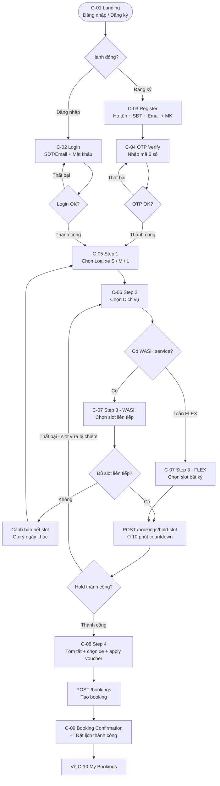
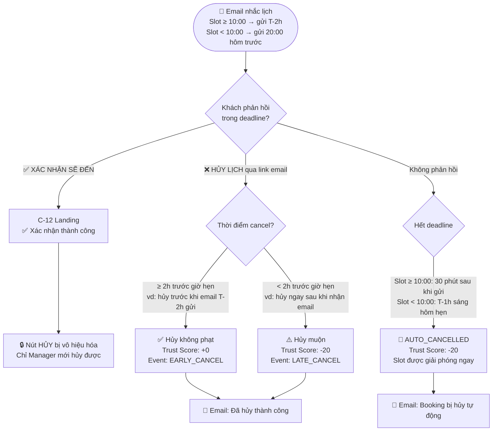
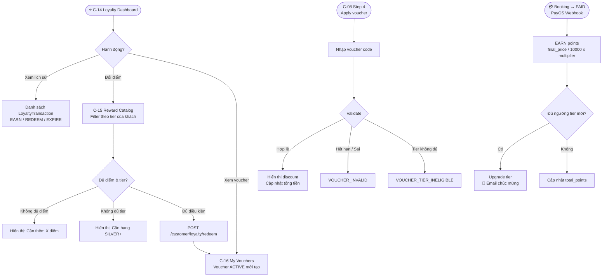
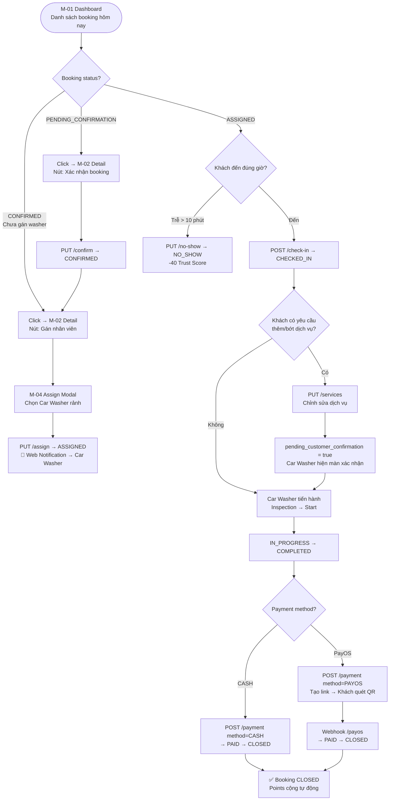
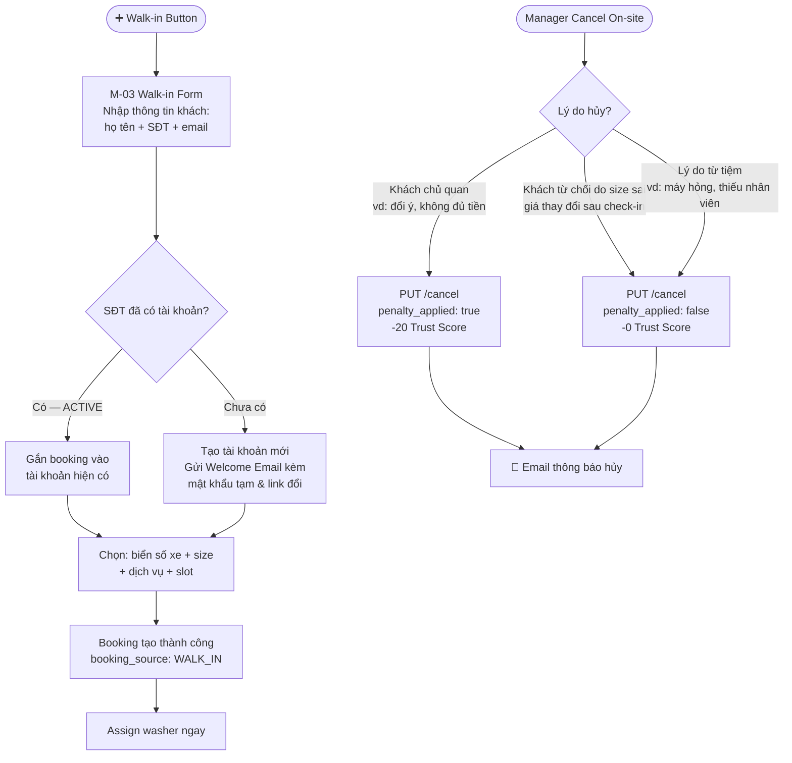
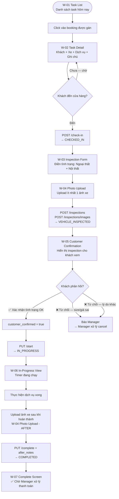

# Wireframe & UI Flow — AutoWash Pro

**BRD:** v2.3 | **Ngày:** 2026-05-23

---

## 1. Screen Inventory

### 1.1 Customer (Web App) — 19 màn hình

| ID | Màn hình | Trigger / Mô tả |
|---|---|---|
| C-01 | Landing / CTA | Màn hình chính: hero banner + nút Đăng nhập / Đăng ký |
| C-02 | Login | Đăng nhập: SĐT/email + mật khẩu |
| C-03 | Register | Tạo tài khoản mới: họ tên, email, SĐT, mật khẩu |
| C-04 | OTP Verify | Nhập mã OTP 6 số gửi qua email |
| C-05 | Step 1 — Loại xe | Chọn S / M / L (có minh họa kích thước xe) |
| C-06 | Step 2 — Dịch vụ | Grouped by category, checkbox + giá theo size xe đã chọn |
| C-07 | Step 3 — Ngày & Giờ | Calendar picker + time slot grid (WASH: liên tiếp, FLEX: tự do) |
| C-08 | Step 4 — Xác nhận | Tóm tắt + chọn xe đã lưu + apply voucher |
| C-09 | Booking Confirmation | Xác nhận thành công + mã booking + QR |
| C-10 | My Bookings | Danh sách booking, lọc theo status tabs |
| C-11 | Booking Detail | Chi tiết đầy đủ + nút hành động theo trạng thái |
| C-12 | T-2h Email Landing | Nút [Xác nhận sẽ đến] / [Hủy lịch] từ link trong email |
| C-13 | Vehicle Management | CRUD xe: biển số, hãng, model, màu, size |
| C-14 | Loyalty Dashboard | Điểm hiện tại + tier + progress bar + lịch sử giao dịch |
| C-15 | Reward Catalog | Danh sách reward có thể đổi điểm (filter theo tier) |
| C-16 | My Vouchers | Voucher đang có (ACTIVE / USED / EXPIRED) |
| C-17 | Rating Screen | 3 tiêu chí (1–5 sao) + comment — chỉ sau CLOSED |
| C-18 | Complaint Form | Tiêu đề + mô tả + upload ảnh (max 7 ngày sau CLOSED) |
| C-19 | Profile / Settings | Thông tin cá nhân + xe + cài đặt thông báo |

### 1.2 Manager (Web App) — 10 màn hình

| ID | Màn hình | Mô tả |
|---|---|---|
| M-01 | Dashboard | Bảng booking hôm nay + quick stats (Tổng / Chờ / Đang làm / Xong) |
| M-02 | Booking Detail | Full info + action buttons theo trạng thái booking |
| M-03 | Walk-in Form | Tạo tài khoản + booking cho khách tại cửa hàng |
| M-04 | Assign Washer | Modal: dropdown chọn nhân viên rảnh |
| M-05 | Slot Management | Grid slot theo ngày, chỉnh washers_online / active_bays |
| M-06 | Complaint List | Bảng khiếu nại + filter theo status |
| M-07 | Complaint Detail | Chi tiết + form ghi resolution + upload response |
| M-08 | Customer Profile View | Trust score + loyalty tier + lịch sử booking của khách |
| M-09 | Reports | Booking stats + doanh thu + washer performance |
| M-10 | Staff List | Danh sách car washer + trạng thái ca |

### 1.3 Car Washer (Web App) — 7 màn hình

| ID | Màn hình | Mô tả |
|---|---|---|
| W-01 | Task List | Danh sách task hôm nay, sắp theo giờ |
| W-02 | Task Detail | Thông tin: khách + xe + dịch vụ + ghi chú |
| W-03 | Inspection Form | Form kiểm tra xe: ngoại thất + nội thất + ghi chú |
| W-04 | Photo Upload | Upload ảnh xe qua file picker (tối thiểu 1 ảnh) |
| W-05 | Customer Confirmation | Hiển thị kết quả inspection cho khách xác nhận |
| W-06 | In-Progress | Màn hình đang thực hiện dịch vụ + timer |
| W-07 | Complete Screen | Xác nhận hoàn thành + ghi chú after inspection |

### 1.4 Admin (Web App) — 9 màn hình

| ID | Màn hình |
|---|---|
| A-01 | User Management — CRUD staff + ban/unban/view customer |
| A-02 | Store Info — Cấu hình thông tin tiệm (tên, địa chỉ, giờ mở cửa) |
| A-03 | Service & Pricing — CRUD dịch vụ + versioned pricing |
| A-04 | Slot Template Config — Lịch tuần mặc định |
| A-05 | Loyalty Config — conversion rate, point expiry |
| A-06 | Tier Config — spending threshold, multiplier, booking window |
| A-07 | Reward Catalog — CRUD phần thưởng |
| A-08 | Audit Log Viewer — filter theo entity, actor, action |
| A-09 | System Reports — Thống kê tổng hợp |

---

## 2. Navigation Structure

```
CUSTOMER WEB (React + Next.js)
━━━━━━━━━━━━━━━━━━━━━━━━━━━━━━
Top Navigation Bar:
├── 🏠 Trang chủ  ──► C-01 CTA
│                        └─► Booking Flow: C-05 → C-06 → C-07 → C-08 → C-09
├── 📋 Lịch hẹn  ──► C-10 My Bookings
│                        └─► C-11 Detail → C-17 Rating / C-18 Complaint
├── ⭐ Loyalty    ──► C-14 Dashboard
│                        ├─► C-15 Reward Catalog → Redeem → C-16
│                        └─► C-16 My Vouchers
└── 👤 Hồ sơ     ──► C-19 Profile
                         └─► C-13 Vehicle Management

Deep links (từ email):
└── confirm-attendance/token ──► C-12 T-2h Landing

MANAGER WEB (Desktop — React/Next.js)
━━━━━━━━━━━━━━━━━━━━━━━━━━━━━━━━━━━━
Left Sidebar:
├── 📊 Dashboard   ──► M-01 (default view)
│                       └─► Click row ──► M-02 Detail
│                                           ├─► M-04 Assign Washer (modal)
│                                           └─► M-08 Customer Profile
├── ➕ Walk-in      ──► M-03 Form (Tạo tài khoản + booking)
├── 🕐 Slot         ──► M-05 Management
├── 💬 Khiếu nại   ──► M-06 List ──► M-07 Detail
├── 📈 Báo cáo     ──► M-09 Reports
└── 👥 Nhân viên   ──► M-10 Staff List

CAR WASHER WEB (React + Next.js)
━━━━━━━━━━━━━━━━━━━━━━━━━━━━━━━
Top Navigation Bar:
├── 📋 Hôm nay  ──► W-01 Task List
│                    └─► W-02 Detail
│                         ├─► W-03 Inspection Form
│                         │    └─► W-04 Photo Upload
│                         │         └─► W-05 Customer Confirm
│                         │              └─► W-06 In-Progress
│                         │                   └─► W-07 Complete
│                         └─► (Đã CLOSED) View only
└── 👤 Hồ sơ   ──► Profile
```

---

## 3. Customer UI Flows

### 3.1 CTA → Booking Flow (Main Journey)



### 3.2 T-2h Notification & Cancellation Flow

> **Lưu ý logic:** Chỉ có 2 kết quả cancel có ý nghĩa. Case `< 30 phút` là **dead branch** — đến thời điểm đó booking đã bị AUTO_CANCELLED (nếu không phản hồi) hoặc bị khóa nút Hủy (nếu đã xác nhận). Không tồn tại path nào để khách tự hủy dưới 30 phút.



### 3.3 Loyalty & Voucher Flow



---

## 4. Manager UI Flows

### 4.1 Daily Operations Flow



### 4.2 Walk-in Booking & Cancellation On-site



---

## 5. Car Washer UI Flow

### 5.1 Task Execution Flow



---

## 6. Key Screen Component Descriptions

### 6.1 Customer

| Screen | Key Components |
|---|---|
| C-01 CTA | AutoWash logo · Hero banner · Đăng nhập / Đăng ký buttons · Dịch vụ highlights |
| C-06 Dịch vụ | Service category headers (WASH / FLEX badge) · Checkbox rows with service name + price · Duration estimate · Sticky bottom: Tổng thời gian + Tổng tiền + Tiếp theo |
| C-07 Slot | Month calendar (disabled dates gray) · Slot grid 07:00–17:30 per 30 min · WASH: highlight N consecutive slots · FLEX: single slot highlight · Legend: Trống / Đặt được / Hết chỗ |
| C-08 Confirm | Booking summary card · Voucher input field · Chọn xe đã lưu · Price breakdown: Tạm tính / Giảm giá / Tổng cộng · CTA: Xác nhận đặt lịch |
| C-09 Confirmation | Checkmark animation · Booking code · Date/time · QR placeholder · CTA: Xem lịch hẹn |
| C-11 Detail | Status progress bar · Service list + prices · Assignment: washer name + avatar · Inspection status badges · Payment status · Action button (per status): Xác nhận đến / Hủy / Đánh giá |
| C-14 Loyalty | Tier badge (MEMBER / SILVER / GOLD / PLATINUM) · Points counter · Progress bar to next tier · Spending needed · Redeem button · Transaction list |

### 6.2 Manager

| Screen | Key Components |
|---|---|
| M-01 Dashboard | Date filter · 4 stat cards (Tổng/Chờ/Đang làm/Xong) · Filter: status dropdown + booking type · Booking table with inline status badges + quick action buttons · Walk-in button (floating or header) |
| M-02 Detail | Customer card: name + phone + trust score badge + tier badge · Vehicle: plate + size + brand · Service list + prices + on-site edit button · Assignment section: washer name + reassign · Inspection status (BEFORE / AFTER) · Payment section + method selector · Cancel button (with penalty options) |
| M-05 Slot | Date picker · Slot grid: time rows × capacity columns · Color coding: Available / Partially booked / Full / Blocked · Click slot → popup: edit washers_online + active_bays |
| M-09 Reports | Tab navigation: Booking / Doanh thu / Nhân viên · Date range picker · Chart area (bar/line placeholder) · Summary table |

### 6.3 Car Washer

| Screen | Key Components |
|---|---|
| W-01 Task List | Date header · Task card: time badge + customer name + plate + services summary + status badge · Empty state: Không có task hôm nay |
| W-03 Inspection | Booking summary mini-card · Textarea: Ngoại thất · Textarea: Nội thất · Notes field · Photo grid (2×2, click to upload ảnh) · Submit button |
| W-05 Customer Confirm | Inspection summary (read-only) · Warning highlights (vết xước, hư hỏng) · Image gallery / Lightbox · "Tôi xác nhận tình trạng xe trước khi rửa" checkbox · Confirm button |
